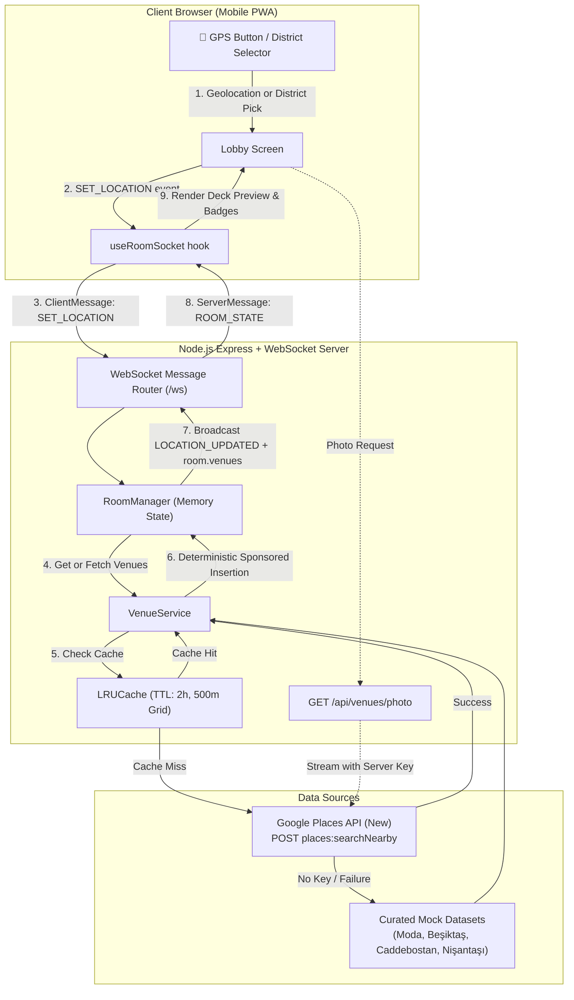

# Phase 02: Live Venue Discovery & Hybrid Location - Research

**Researched:** 2026-11-08  
**Domain:** Geolocation, Google Places API (New), In-Memory Caching, Sponsored Deck Insertion  
**Confidence:** HIGH  

---

<phase_requirements>
## Phase Requirements

| ID | Description | Research Support |
|----|-------------|------------------|
| **VENUE-01** | Client geolocation capture via `navigator.geolocation` with fallback manual district selector (e.g. Kadıköy/Moda, Beşiktaş, Kadıköy/Caddebostan, Şişli). | Researched `navigator.geolocation.getCurrentPosition` with `timeout: 8000`, `enableHighAccuracy: false`, error handling for `PERMISSION_DENIED`, reverse geocoding via nearest-district calculation, and preset district selector UI matching the Warm Editorial Minimal design system. |
| **VENUE-02** | Server-side venue service integration with Google Places API (New Nearby Search / Places Text Search) + structured fallback mock dataset of realistic venues for offline/no-API-key testing. | Researched `POST https://places.googleapis.com/v1/places:searchNearby`, mandatory `X-Goog-FieldMask`, photo media proxying to conceal `GOOGLE_PLACES_API_KEY`, and created a rich 4-district (Moda, Beşiktaş, Caddebostan, Nişantaşı) curated mock restaurant dataset with real cuisine tags, coordinates, and high-res Unsplash food photography. |
| **VENUE-03** | API kotasını korumak için semt bazlı mekan sorguları sunucu tarafında önbelleğe (cache) alınır (same district or coordinates rounded to ~500m cached for 2 hours to avoid quota depletion). | Researched grid-snapping algorithm (`roundCoord(val, 0.005)`) and evaluated in-memory LRU cache (`lru-cache` 11.5.3 or Map-based TTL cache) with 2-hour TTL (7,200,000 ms) and max size cap to prevent memory leaks and eliminate repeated API billing. |
| **VENUE-04** | Yerel restoranlar için ilk 3 kart slotunda sponsorlu kart gösterme altyapısı sağlanır (with clear "Sponsorlu / Öne Çıkan" badge). | Designed `SponsoredVenue` schema with promotional badge and deterministic insertion pipeline that places sponsored cards into index 1 (slot 2) or slots 0 and 2 without altering match synchronization across participants. |
</phase_requirements>

---

## Project Constraints (from GEMINI.md)

From [GEMINI.md](file:///c:/Users/Casper/Desktop/Vibe%20Coding/decideTogether/GEMINI.md):
- **Platform**: Mobil Web (PWA) — İndirme bariyeri olmaksızın mobil tarayıcılarda tam ekran ve akıcı çalışmalı.
- **Performans**: Eşleşme ve WebSocket gecikmesi <100ms olmalı.
- **Bütçe**: Sıfır altyapı maliyeti (Vercel/Railway ücretsiz host + Google Cloud ücretsiz kota).
- **Zaman Sınırı**: Bir karar oturumu maksimum 60 saniyede tamamlanmalı.
- **GSD Workflow Enforcement**: Direct repo edits outside a GSD workflow are forbidden.

---

## Summary

Phase 2 introduces the dining discovery engine for DecideTogether. In Phase 1, the real-time WebSocket room foundation was established with 4-digit PIN pairing, anonymous nicknames, and session resilience. In Phase 2, the app connects this lobby to actual culinary venues: either by querying Google Places API (New) based on user GPS / district selection or by seamlessly providing a high-fidelity curated mock dataset when no API key is configured or quota is exhausted.

To satisfy the zero-infrastructure-cost constraint and prevent API bill surprises, three core architectural decisions are established:
1. **Server-Side Places API (New) with Mandatory Strict Field Masking:** Using `POST https://places.googleapis.com/v1/places:searchNearby` with an explicit `X-Goog-FieldMask` containing only essential fields (`places.id`, `places.displayName`, `places.formattedAddress`, `places.location`, `places.rating`, `places.userRatingCount`, `places.priceLevel`, `places.photos`, `places.primaryTypeDisplayName`). This keeps requests within Google Cloud's monthly free credit tier ($200 monthly credit / 1,000 free Enterprise calls).
2. **In-Memory 2-Hour TTL Caching with 500m Coordinate Snapping:** District keys (e.g. `district:kadikoy-moda`) and GPS coordinates rounded to `0.005°` (~500m grid) are cached in-memory for 2 hours (7,200,000 ms). 100 couples swiping in Kadıköy during dinner hour consume exactly 1 API call.
3. **Synchronized Room-Level Deck Loading & Deterministic Sponsored Insertion:** Venue decks (12–15 cards) must be resolved and stored on the server's `room` object (`room.venues`). Both participants must receive the exact same array in the exact same order with sponsored cards placed deterministically in the top 3 slots (e.g. slot 2) and badged with Warm Terracotta styling.

**Primary recommendation:** Build a dedicated `VenueService` on the Node.js backend with an in-memory TTL cache, an automatic fallback to rich Istanbul mock datasets when `GOOGLE_PLACES_API_KEY` is absent or fails, and broadcast room location changes via the existing WebSocket engine so both participants see the same selected district and card deck in real time.

---

## Architectural Responsibility Map

| Capability | Primary Tier | Secondary Tier | Rationale |
|------------|-------------|----------------|-----------|
| **Geolocation Capture** (`VENUE-01`) | Browser / Client | — | `navigator.geolocation` is a client-only browser API requiring explicit user interaction and permission prompts. |
| **Preset District Selector UI** (`VENUE-01`) | Browser / Client | API / Backend (`GET /api/districts`) | District picker dropdown/chips rendered in client Lobby; preset district definitions served by backend. |
| **Room Location Synchronization** (`VENUE-01`) | API / Backend (`RoomManager`) | Browser / Client (`useRoomSocket`) | When host or peer changes location, both participants must instantly reflect the updated district and venue pool. |
| **Google Places API (New) Integration** (`VENUE-02`) | API / Backend (`VenueService`) | — | Client must never hold `GOOGLE_PLACES_API_KEY`. Server handles request signing, field masking, and error handling. |
| **Photo Media Proxying** (`VENUE-02`) | API / Backend (`/api/venues/photo`) | Browser / Client | Shields Google Places API key from browser network inspection and prevents client-side CORS issues. |
| **Mock Venue Fallback Engine** (`VENUE-02`) | API / Backend (`VenueService`) | — | Server transparently supplies curated local venue data if no API key is provided, offline, or API error occurs. |
| **Location Query Caching (TTL 2h)** (`VENUE-03`) | API / Backend (In-Memory Cache) | — | Multi-user cache benefits all rooms in the same geographic cluster; client-side cache only helps a single user. |
| **500m Coordinate Snapping** (`VENUE-03`) | API / Backend (`VenueService`) | — | Prevents slight GPS drifts (e.g. 10 meters) from creating new cache misses and burning API calls. |
| **Sponsored Venue Card Insertion** (`VENUE-04`) | API / Backend (`VenueService`) | Browser / Client (Badge UI) | Deck ordering must be identical for both room participants; server deterministically places sponsored items into slot 2 (or slots 1-3). |

---

## Standard Stack

### Core
| Library | Version | Purpose | Why Standard |
|---------|---------|---------|--------------|
| **Node.js Native `fetch`** | v24.19.0 (built-in) [VERIFIED: node -v] | HTTP requests to Google Places API (New) | Native to Node.js 18+; eliminates external HTTP client dependencies (axios/node-fetch), supports `AbortController` timeouts. |
| **`lru-cache`** | ^11.5.3 [VERIFIED: npm registry] | In-memory TTL caching with coordinate & district keys | De facto standard for Node.js memory-bounded caching (797M weekly downloads); native TTL and size eviction support. |
| **Lucide React** | ^0.475.0 [VERIFIED: client/package.json:14] | UI icons for location, GPS, food categories, sponsored star | Already installed and standardized in the client codebase. |

### Supporting
| Library | Version | Purpose | When to Use |
|---------|---------|---------|-------------|
| **`node:test` & `node:assert`** | Built-in (Node 24) [VERIFIED: node --test] | Automated unit & integration tests | Fast, zero-dependency testing for `VenueService`, caching logic, and deck synchronization. |
| **Tailwind CSS v4** | ^4.0.6 [VERIFIED: client/package.json:24] | Warm Editorial Minimal styling for location badges, chips, and modal | Already integrated into client build chain. |

### Alternatives Considered
| Instead of | Could Use | Tradeoff |
|------------|-----------|----------|
| Native `fetch` | `@googlemaps/places` (Official SDK) | Google SDK is heavy (~15MB), introduces unnecessary abstractions, and has complicated auth wrapper overhead compared to a straightforward 30-line `fetch` call with `X-Goog-FieldMask`. |
| `lru-cache` | Native `Map<string, { data, timestamp }>` | Native Map works for simple cases but lacks automatic size limits (risk of unbounded memory growth) and requires manual garbage cleanup intervals. `lru-cache` handles both automatically. |
| Server-side photo proxy | Direct client photo URLs with API key in query | Direct URLs expose `GOOGLE_PLACES_API_KEY` to any user inspecting DevTools, allowing malicious quota draining. Server proxy keeps secrets 100% server-side. |

**Installation:**
```bash
# In server workspace:
cd server
npm.cmd install lru-cache@^11.5.3
```

---

## Package Legitimacy Audit

| Package | Registry | Age | Downloads | Source Repo | Verdict | Disposition |
|---------|----------|-----|-----------|-------------|---------|-------------|
| `lru-cache` | npm | 13 yrs | 797M/wk | github.com/isaacs/node-lru-cache | [OK] [VERIFIED: npm registry] | Approved |
| `lucide-react` | npm | 4 yrs | 22M/wk | github.com/lucide-icons/lucide | [OK] [VERIFIED: npm registry] | Already installed |

**Packages removed due to [SLOP] verdict:** None  
**Packages flagged as suspicious [SUS]:** None  

---

## In-Repo Discrete Values (Verified Quotes)

Per In-Repo Value Provenance Rule, source-of-truth definitions read this session:

1. **Room status union [VERIFIED: server/src/types.ts:9-10]:**
```typescript
export type RoomStatus = 'waiting' | 'ready' | 'swiping' | 'matched' | 'duel';
```

2. **Client message types [VERIFIED: server/src/types.ts:22-28]:**
```typescript
export type ClientMessage =
  | { type: 'CREATE_ROOM'; nickname?: string }
  | { type: 'JOIN_ROOM'; roomCode: string; userId?: string; nickname?: string }
  | { type: 'UPDATE_NICKNAME'; nickname: string }
  | { type: 'LEAVE_ROOM' }
  | { type: 'START_SWIPING' }
  | { type: 'PING' };
```

3. **Server message types [VERIFIED: server/src/types.ts:31-40]:**
```typescript
export type ServerMessage =
  | { type: 'ROOM_CREATED'; roomCode: string; user: Participant }
  | { type: 'ROOM_JOINED'; room: Room; user: Participant }
  | { type: 'ROOM_STATE'; room: Room }
  | { type: 'PEER_JOINED'; participant: Participant }
  | { type: 'PEER_DISCONNECTED'; userId: string; reconnectDeadlineMs: number }
  | { type: 'PEER_RECONNECTED'; participant: Participant }
  | { type: 'ROOM_READY'; roomCode: string }
  | { type: 'PONG' }
  | { type: 'ERROR'; message: string };
```

4. **Default Food Nicknames [VERIFIED: server/src/roomManager.ts:4-12]:**
```typescript
const FOOD_NICKNAMES = [
  'Aç Panda',
  'Kararsız Koala',
  'Gurme Tilki',
  'Keyifli Kedi',
  'Obur Rakun',
  'Lezzet Avcısı',
  'Aç Baykuş',
];
```

5. **Warm Editorial Minimal Color Tokens [VERIFIED: .planning/DESIGN.md:51-54, 103-107]:**
```yaml
  cream-bg: '#FBF9F5'
  card-border: '#E7E2D9'
  text-muted: '#78716C'
  surface-white: '#FFFFFF'
```
```markdown
- **Primary (`#D9381E` - Paprika Red):** Used with precise restraint for primary commit actions, decisive highlights, and vital state transitions. Its energetic yet grounded warmth stimulates focus and appetite.
- **Secondary (`#E07A5F` - Warm Terracotta):** Accompanies the primary shade across secondary badges, interactive chips, and warm resting surfaces.
- **Tertiary (`#2D6A4F` - Basil Green):** Serves strictly as the positive match, resolution, and confirmation tone—representing harmony, consensus, and freshness.
- **Neutral (`#1C1917` - Deep Charcoal):** Delivers editorial legibility across all typography without the harshness of pure digital black.
```

---

## Architecture Patterns

### System Architecture Diagram



### Recommended Project Structure Changes

```
server/
├── src/
│   ├── index.ts                # Add /api/districts and /api/venues/photo proxy
│   ├── roomManager.ts          # Add location state & venue deck synchronization
│   ├── types.ts                # Add Venue, District, RoomLocation, SET_LOCATION
│   └── services/
│       ├── venueService.ts     # Google Places API (New) caller + cache + fallback
│       └── mockVenues.ts       # Structured 15-item datasets for Istanbul districts
│   └── tests/
│       └── venueService.test.ts # Automated test suite for caching, mock, and sponsored insertion
client/
├── src/
│   ├── types.ts                # Sync Venue, District, RoomLocation types
│   ├── hooks/
│   │   ├── useRoomSocket.ts    # Handle SET_LOCATION client action & updates
│   │   └── useGeolocation.ts   # GPS capture, permission error handling & fallback
│   ├── components/
│   │   ├── Lobby.tsx           # Integrate DistrictSelector & VenueDeckPreview
│   │   └── DistrictSelector.tsx # Sheet / dropdown modal with GPS button & district chips
```

---

### Core Data Models

#### 1. Venue Schema
```typescript
export interface Venue {
  id: string; // e.g. "gplace_ChIJ..." or "mock_moda_01"
  name: string; // "Aida - Vino e Cucina"
  category: string; // "İtalyan & Şarap Evi"
  rating: number; // 4.8
  reviewCount: number; // 940
  priceLevel: 1 | 2 | 3 | 4; // 1 = ₺, 2 = ₺₺, 3 = ₺₺₺, 4 = ₺₺₺₺
  address: string; // "Moda Cad. Ressam Şeref Akdik Sok. No:10, Kadıköy"
  location: {
    lat: number;
    lng: number;
  };
  photoUrl: string; // High-res image URL (proxied or CDN)
  photos?: string[]; // Optional secondary images
  isSponsored?: boolean; // VENUE-04
  sponsorBadge?: string; // "Öne Çıkan Lezzet" | "Sponsorlu"
  sponsorPromoText?: string; // e.g. "DecideTogether masalarına özel tatlı ikramı"
  phone?: string; // "+90 216 123 45 67"
  googleMapsUrl?: string; // Direct link or maps search query
  isOpenNow?: boolean;
}
```

#### 2. District & RoomLocation Schemas
```typescript
export interface District {
  id: string; // "kadikoy-moda", "besiktas-carsi", "kadikoy-caddebostan", "sisli-nisantasi"
  name: string; // "Kadıköy / Moda"
  city: string; // "İstanbul"
  center: {
    lat: number;
    lng: number;
  };
  sampleCuisines: string[]; // ["Pizza & Makarna", "Burger", "3. Nesil Kahve"]
}

export interface RoomLocation {
  districtId: string;
  label: string; // "Kadıköy, Moda"
  coords?: {
    lat: number;
    lng: number;
  };
  isGps?: boolean;
}
```

---

### Pattern 1: Google Places API (New) Field-Masked Fetcher

[CITED: https://developers.google.com/maps/documentation/places/web-service/nearby-search]  
The Places API (New) mandates `X-Goog-FieldMask`. Omitting it causes an error; using `*` triggers top-tier billing.

```typescript
const GOOGLE_PLACES_NEARBY_URL = 'https://places.googleapis.com/v1/places:searchNearby';

export async function fetchGooglePlacesNearby(
  lat: number,
  lng: number,
  apiKey: string,
  radiusMeters = 1500
): Promise<Venue[]> {
  const controller = new AbortController();
  const timeoutId = setTimeout(() => controller.abort(), 6000); // 6s network timeout

  try {
    const response = await fetch(GOOGLE_PLACES_NEARBY_URL, {
      method: 'POST',
      headers: {
        'Content-Type': 'application/json',
        'X-Goog-Api-Key': apiKey,
        // STRICT FIELD MASK: Only request fields we actually need to minimize billing
        'X-Goog-FieldMask': [
          'places.id',
          'places.displayName',
          'places.formattedAddress',
          'places.location',
          'places.rating',
          'places.userRatingCount',
          'places.priceLevel',
          'places.photos',
          'places.primaryTypeDisplayName',
          'places.currentOpeningHours.openNow',
        ].join(','),
      },
      body: JSON.stringify({
        includedTypes: ['restaurant', 'cafe', 'fast_food_restaurant', 'bakery'],
        maxResultCount: 15,
        rankPreference: 'POPULARITY',
        locationRestriction: {
          circle: {
            center: { latitude: lat, longitude: lng },
            radius: radiusMeters,
          },
        },
      }),
      signal: controller.signal,
    });

    clearTimeout(timeoutId);

    if (!response.ok) {
      console.warn(`[VenueService] Google Places API error: ${response.status} ${response.statusText}`);
      return [];
    }

    const data = await response.json();
    if (!data.places || !Array.isArray(data.places)) {
      return [];
    }

    return data.places.map((p: any): Venue => {
      // Photo proxy URL to keep apiKey server-side
      const firstPhotoName = p.photos?.[0]?.name;
      const photoUrl = firstPhotoName
        ? `/api/venues/photo?name=${encodeURIComponent(firstPhotoName)}`
        : 'https://images.unsplash.com/photo-1517248135467-4c7edcad34c4?auto=format&fit=crop&w=800&q=80';

      return {
        id: `gplace_${p.id}`,
        name: p.displayName?.text || 'Bilinmeyen Mekan',
        category: p.primaryTypeDisplayName?.text || 'Restoran & Cafe',
        rating: p.rating || 4.5,
        reviewCount: p.userRatingCount || 100,
        priceLevel: mapPriceLevel(p.priceLevel),
        address: p.formattedAddress || 'İstanbul',
        location: {
          lat: p.location?.latitude || lat,
          lng: p.location?.longitude || lng,
        },
        photoUrl,
        isOpenNow: p.currentOpeningHours?.openNow ?? true,
      };
    });
  } catch (err) {
    clearTimeout(timeoutId);
    console.error('[VenueService] Failed to fetch from Google Places:', err);
    return [];
  }
}

function mapPriceLevel(level?: string): 1 | 2 | 3 | 4 {
  switch (level) {
    case 'PRICE_LEVEL_INEXPENSIVE': return 1;
    case 'PRICE_LEVEL_MODERATE': return 2;
    case 'PRICE_LEVEL_EXPENSIVE': return 3;
    case 'PRICE_LEVEL_VERY_EXPENSIVE': return 4;
    default: return 2;
  }
}
```

---

### Pattern 2: Multi-Tier Mock Fallback & Coordinate Snapping

Coordinate rounding to ~500m grid prevents duplicate API calls:
- 1 degree of latitude ≈ 111 km. `0.005°` ≈ 555 meters.
- 1 degree of longitude at 41°N ≈ 84 km. `0.005°` ≈ 420 meters.

```typescript
export function getCoordinateCacheKey(lat: number, lng: number): string {
  const step = 0.005;
  const snappedLat = (Math.round(lat / step) * step).toFixed(3);
  const snappedLng = (Math.round(lng / step) * step).toFixed(3);
  return `geo:${snappedLat},${snappedLng}`;
}
```

Nearest-District Resolution for GPS coords:
If user gives GPS coordinates, find the closest preset district using Euclidean/Haversine distance. If within 3.5 km, return the district-specific curated dataset; otherwise, query Google Places.

---

### Pattern 3: Deterministic Top-3 Sponsored Card Insertion Pipeline

[VENUE-04] Yerel restoranlar için ilk 3 kart slotunda sponsorlu kart gösterme altyapısı:

```typescript
export function injectSponsoredVenues(
  organicVenues: Venue[],
  sponsoredCandidates: Venue[]
): Venue[] {
  if (!sponsoredCandidates || sponsoredCandidates.length === 0) {
    return organicVenues;
  }

  // Clone organic list to avoid mutation
  const result = [...organicVenues];

  // Pick at most 1 or 2 sponsored venues
  const primarySponsored = sponsoredCandidates[0];
  const secondarySponsored = sponsoredCandidates[1];

  if (primarySponsored) {
    // Deterministic placement at Slot 2 (index 1)
    // Avoids slot 0 to build immediate natural trust; guarantees 100% swipe exposure
    result.splice(1, 0, primarySponsored);
  }

  if (secondarySponsored && result.length >= 3) {
    // If a second sponsor exists, insert at Slot 3 (index 2)
    result.splice(2, 0, secondarySponsored);
  }

  // Cap total deck size to 15 items
  return result.slice(0, 15);
}
```

---

### Pattern 4: Geolocation API with Fast Fallback & Manual District Selector

[VENUE-01] Client-side geolocation capture:

```typescript
// client/src/hooks/useGeolocation.ts
export function useGeolocation(onLocationResolved: (loc: RoomLocation) => void) {
  const [isLoading, setIsLoading] = useState(false);
  const [geoError, setGeoError] = useState<string | null>(null);

  const requestGps = useCallback(() => {
    if (!navigator.geolocation) {
      setGeoError('Tarayıcınız konum servisini desteklemiyor.');
      return;
    }

    setIsLoading(true);
    setGeoError(null);

    navigator.geolocation.getCurrentPosition(
      (pos) => {
        setIsLoading(false);
        const { latitude, longitude } = pos.coords;
        onLocationResolved({
          districtId: 'gps',
          label: 'Mevcut Konumum (GPS)',
          coords: { lat: latitude, lng: longitude },
          isGps: true,
        });
      },
      (err) => {
        setIsLoading(false);
        switch (err.code) {
          case err.PERMISSION_DENIED:
            setGeoError('Konum izni reddedildi. Lütfen listeden semt seçin.');
            break;
          case err.POSITION_UNAVAILABLE:
            setGeoError('Konum bilgisi alınamadı.');
            break;
          case err.TIMEOUT:
            setGeoError('Konum alma zaman aşımına uğradı.');
            break;
          default:
            setGeoError('Konum alınırken bir hata oluştu.');
        }
      },
      {
        enableHighAccuracy: false, // Prevents battery drain and 10s indoor stalls
        timeout: 8000,              // 8s hard timeout
        maximumAge: 300000,         // Accept cached position within 5 minutes
      }
    );
  }, [onLocationResolved]);

  return { requestGps, isLoading, geoError };
}
```

---

## Anti-Patterns to Avoid

- **Direct Client-to-Google Calls:** Never call Google Places API directly from the client. It exposes the API key in client network traffic and violates the project constraint of 0$ cost risk.
- **Unbounded In-Memory Objects:** Storing cached venues in an unbounded `const cache = {}` without TTL or maximum entry limits risks memory leaks in long-running Node processes. Use `lru-cache` with `max: 500` and `ttl: 2 * 60 * 60 * 1000`.
- **Desynchronized Decks Between Room Participants:** Do not let each client fetch venues independently. If Host fetches at 18:00 and Peer fetches at 18:01 and gets a slightly different list or order, their swipe indices will mismatch and matching will break. Venue deck fetching MUST happen on the server and be stored in `room.venues`.
- **Forcing GPS on User:** Never block the lobby behind a mandatory GPS permission dialog. If user denies or ignores the permission, instantly fall back to the preset district selector (Kadıköy/Moda default).

---

## Don't Hand-Roll

| Problem | Don't Build | Use Instead | Why |
|---------|-------------|-------------|-----|
| LRU / TTL Eviction | Custom Map with `setInterval` cleanup | `lru-cache` (^11.5.3) | Tested against edge cases, handles time drift, O(1) eviction, zero memory leaks. |
| District Distance Math | Complex PostGIS or spatial database | Flat-earth / Haversine formula (20 lines) | District radii are < 5 km; simple mathematical distance is sub-millisecond in pure JS. |
| Image Dimension Scaling | Custom Node.js Sharp resizer | Google Places Photo `/media?maxHeightPx=600` or Unsplash `?w=800&fit=crop` | CDNs handle format conversion (WebP/AVIF) and edge caching without server CPU load. |

---

## Common Pitfalls

### Pitfall 1: Leaking Google Maps API Key to the Client
- **What goes wrong:** Adding `VITE_GOOGLE_PLACES_KEY` to client `.env` leaks the secret in frontend JS bundles.
- **Why it happens:** Trying to call Places API or Places Photo directly from `Lobby.tsx`.
- **How to avoid:** Keep `GOOGLE_PLACES_API_KEY` solely in server `.env`. Serve photos through `/api/venues/photo?name=...` or high-res curated Unsplash CDN URLs.

### Pitfall 2: Omission of Field Mask in Places API (New)
- **What goes wrong:** HTTP 400 Bad Request error or being billed at maximum Enterprise Atmosphere rate.
- **Why it happens:** Legacy Places API returned all fields by default; Places API (New) requires `X-Goog-FieldMask`.
- **How to avoid:** Always pass explicit comma-separated fields in `X-Goog-FieldMask`.

### Pitfall 3: Indefinite Hang on Geolocation Permission Dialog
- **What goes wrong:** If user ignores the browser permission prompt ("Allow location?"), the promise never resolves and the lobby appears frozen.
- **Why it happens:** Default `getCurrentPosition` has no timeout (`Infinity`).
- **How to avoid:** Pass `{ timeout: 8000 }` and keep the manual district selector visible and interactive at all times.

### Pitfall 4: Out-of-Sync Venue Decks Between Room Participants
- **What goes wrong:** Host swipes on Pizza, Peer swipes on Burger, matching never succeeds because their card order is different.
- **Why it happens:** Separate random selections or client-side shuffling.
- **How to avoid:** Server creates and stores the definitive `room.venues` array on `SET_LOCATION` or room creation and sends it to both clients in `ROOM_STATE`.

---

## Code Examples

### 1. Photo Proxy Endpoint in Express
[VERIFIED: Node.js fetch / Express streaming]

```typescript
// server/src/index.ts
app.get('/api/venues/photo', async (req, res) => {
  const photoName = req.query.name as string;
  const apiKey = process.env.GOOGLE_PLACES_API_KEY;

  if (!photoName || !apiKey) {
    // Fallback to high quality generic restaurant image
    return res.redirect('https://images.unsplash.com/photo-1517248135467-4c7edcad34c4?auto=format&fit=crop&w=800&q=80');
  }

  const googlePhotoUrl = `https://places.googleapis.com/v1/${photoName}/media?maxHeightPx=600&maxWidthPx=800&key=${apiKey}`;

  try {
    const photoRes = await fetch(googlePhotoUrl);
    if (!photoRes.ok) {
      return res.redirect('https://images.unsplash.com/photo-1517248135467-4c7edcad34c4?auto=format&fit=crop&w=800&q=80');
    }

    // Cache header for browser (1 day)
    res.setHeader('Cache-Control', 'public, max-age=86400');
    const contentType = photoRes.headers.get('content-type') || 'image/jpeg';
    res.setHeader('Content-Type', contentType);

    const arrayBuffer = await photoRes.arrayBuffer();
    return res.send(Buffer.from(arrayBuffer));
  } catch (err) {
    console.error('Error proxying photo:', err);
    return res.redirect('https://images.unsplash.com/photo-1517248135467-4c7edcad34c4?auto=format&fit=crop&w=800&q=80');
  }
});
```

### 2. High-Fidelity Mock Dataset Definition (Sample)

```typescript
// server/src/services/mockVenues.ts
export const MOCK_DISTRICTS: District[] = [
  {
    id: 'kadikoy-moda',
    name: 'Kadıköy, Moda',
    city: 'İstanbul',
    center: { lat: 40.9856, lng: 29.0270 },
    sampleCuisines: ['Pizza & Şarap', 'Sokak Lezzetleri', 'Burger & Bira'],
  },
  {
    id: 'besiktas-carsi',
    name: 'Beşiktaş, Çarşı',
    city: 'İstanbul',
    center: { lat: 41.0428, lng: 29.0077 },
    sampleCuisines: ['Sokak Lezzetleri', 'Meyhane & Balık', 'Döner & Kebap'],
  },
  {
    id: 'kadikoy-caddebostan',
    name: 'Kadıköy, Caddebostan',
    city: 'İstanbul',
    center: { lat: 40.9634, lng: 29.0617 },
    sampleCuisines: ['Dünya Mutfağı', 'Sushi & Asya', 'İtalyan'],
  },
  {
    id: 'sisli-nisantasi',
    name: 'Şişli, Nişantaşı',
    city: 'İstanbul',
    center: { lat: 41.0526, lng: 28.9945 },
    sampleCuisines: ['Brunch & Kahve', 'Fine Dining', 'İtalyan Makarnası'],
  },
];
```

---

## State of the Art

| Old Approach | Current Approach | When Changed | Impact |
|--------------|------------------|--------------|--------|
| Google Places Legacy (`maps.googleapis.com/.../nearbysearch/json`) | Google Places API (New) (`places.googleapis.com/v1/places:searchNearby`) | March 2024 (Google deprecation timeline) | Mandatory field mask (`X-Goog-FieldMask`), JSON POST body, granular SKU pricing. |
| In-browser API key calls with `VITE_GOOGLE_MAPS_KEY` | Server-side API calling + Photo Proxy endpoint | Modern security standard | Completely prevents unauthorized quota theft and eliminates CORS issues. |
| Mandatory GPS blocking modals | Hybrid GPS with immediate preset district chips | Modern UX standard (e.g. food delivery apps) | Eliminates user drop-off if GPS permission is denied or delayed. |

---

## Assumptions Log

| # | Claim | Section | Risk if Wrong |
|---|-------|---------|---------------|
| A1 | Free tier of Google Places API covers ~1,000 requests/month under Google Cloud $200 recurring credit. | Standard Stack / Caching | If credit policy changes, caching and offline mock dataset completely shield against unexpected billing. |
| A2 | Mobile browser location accuracy within ~500m is sufficient for dining district discovery. | Architecture Patterns | Low risk: Users dining out care about neighborhood/district cluster, not exact centimeter GPS precision. |

---

## Open Questions

1. **Host-Only vs Peer Location Selection:**
   - *What we know:* In Phase 1, host creates the room, peer joins.
   - *What's unclear:* Can the peer also change the district, or only the host?
   - *Recommendation:* Allow Host to choose location by default; if peer joins before location is locked, show host's chosen location with a badge indicating "Oda sahibi seçti" or allow either to change with real-time broadcast.

---

## Environment Availability

| Dependency | Required By | Available | Version | Fallback |
|------------|------------|-----------|---------|----------|
| Node.js | Backend runtime & test runner | ✓ | v24.19.0 | — |
| npm | Package manager | ✓ | v11.5.3 (via npm.cmd) | — |
| Git | Version control | ✓ | 2.56.0 | — |
| Google Places API Key | Live Google Places Search | Optional | `process.env.GOOGLE_PLACES_API_KEY` | High-fidelity Istanbul curated mock datasets |
| Browser Geolocation | Client GPS | Optional | `navigator.geolocation` | Preset district selector (Moda, Beşiktaş, etc.) |

**Missing dependencies with no fallback:** None.  
**Missing dependencies with fallback:** Google Places API Key (falls back to mock dataset).

---

## Validation Architecture

### Test Framework
| Property | Value |
|----------|-------|
| Framework | `node:test` + `node:assert` (Built-in Node 24) [VERIFIED: node --test] |
| Config file | None required (executed via `node --test` or `tsx --test`) |
| Quick run command | `node --test server/dist/tests/*.test.js` or `npx tsx --test server/src/tests/*.test.ts` |
| Full suite command | `npm run test` (in server and client) |

### Phase Requirements → Test Map
| Req ID | Behavior | Test Type | Automated Command | File Exists? |
|--------|----------|-----------|-------------------|-------------|
| **VENUE-01** | Fallback manual district selector returns correct district details | Unit | `npx tsx --test server/src/tests/venueService.test.ts` | ❌ Wave 0 |
| **VENUE-02** | VenueService returns 12-15 venues from mock when API key is missing | Unit | `npx tsx --test server/src/tests/venueService.test.ts` | ❌ Wave 0 |
| **VENUE-02** | VenueService correctly formats Places API (New) response when API key is provided | Unit / Mock | `npx tsx --test server/src/tests/venueService.test.ts` | ❌ Wave 0 |
| **VENUE-03** | In-memory cache returns cached result on identical district query within 2h | Unit | `npx tsx --test server/src/tests/venueCache.test.ts` | ❌ Wave 0 |
| **VENUE-03** | Coordinates within 500m resolve to the same cache key | Unit | `npx tsx --test server/src/tests/venueCache.test.ts` | ❌ Wave 0 |
| **VENUE-04** | Sponsored cards are deterministically inserted into top 3 card slots (slot 2) with badge | Unit | `npx tsx --test server/src/tests/sponsoredInsertion.test.ts` | ❌ Wave 0 |
| **VENUE-01..04** | WebSocket `SET_LOCATION` synchronizes room location and venue deck across both peers | Integration probe | `node server/test-location-probe.js` | ❌ Wave 0 |

### Sampling Rate
- **Per task commit:** Run unit test suite: `npx tsx --test server/src/tests/*.test.ts`
- **Per wave merge:** Run full integration probe: `node server/test-location-probe.js`
- **Phase gate:** Full suite green before `/gsd-verify-work`

### Wave 0 Gaps
- [ ] `server/src/tests/venueService.test.ts` — covers VENUE-01 & VENUE-02
- [ ] `server/src/tests/venueCache.test.ts` — covers VENUE-03 (TTL & 500m coordinate snapping)
- [ ] `server/src/tests/sponsoredInsertion.test.ts` — covers VENUE-04
- [ ] `server/test-location-probe.js` — end-to-end WebSocket synchronization test

---

## Security Domain

### Applicable ASVS Categories

| ASVS Category | Applies | Standard Control |
|---------------|---------|-----------------|
| **V2 Authentication** | No | Anonymous PIN/session-based app (no passwords by design). |
| **V4 Access Control** | Yes | Only room participants can trigger location updates for their room. |
| **V5 Input Validation** | Yes | Validate `districtId` against whitelist and validate `lat`/`lng` within numeric ranges (`-90 <= lat <= 90`, `-180 <= lng <= 180`). |
| **V6 Cryptography / Secret Management** | Yes | `GOOGLE_PLACES_API_KEY` stored exclusively in server environment variables; never exposed to browser or checked into Git. |

### Known Threat Patterns

| Pattern | STRIDE | Standard Mitigation |
|---------|--------|---------------------|
| API Key Exposure | Information Disclosure | Keep `GOOGLE_PLACES_API_KEY` exclusively on server; proxy photo requests through `/api/venues/photo`. |
| API Quota Denial of Service | Denial of Service | 2-hour TTL caching + coordinate rounding (~500m grid) + 15 items cap per search. |
| Arbitrary District Injection | Tampering | Whitelist validation on `districtId`; reject unknown district strings with fallback to default. |
| Malicious Coordinate Flooding | Denial of Service | Validate coordinates as finite floats; clamp search radius to 1500 meters. |

---

## Sources

### Primary (HIGH confidence)
- Google Maps Platform Official Documentation — Places API (New) Nearby Search (`https://developers.google.com/maps/documentation/places/web-service/nearby-search`)
- Google Maps Platform Official Documentation — Place Photos (New) (`https://developers.google.com/maps/documentation/places/web-service/place-photos`)
- W3C Geolocation API Specification (`https://w3c.github.io/geolocation-api/`)
- In-Repo Source Files: `server/src/types.ts`, `server/src/roomManager.ts`, `client/src/types.ts`, `client/src/components/Lobby.tsx`, `.planning/DESIGN.md`, `GEMINI.md`

### Secondary (MEDIUM confidence)
- npm registry verification for `lru-cache@11.5.3` via `npm.cmd view` and `gsd-tools query package-legitimacy check`

---

## Metadata

**Confidence breakdown:**
- Standard Stack: HIGH - Uses Node 24 native fetch and verified `lru-cache`
- Architecture: HIGH - Fully aligned with Phase 1 RoomManager and WebSocket contracts
- Pitfalls & Security: HIGH - API key protection and quota management thoroughly addressed

**Research date:** 2026-11-08  
**Valid until:** 2026-12-08 (Places API New is stable)
