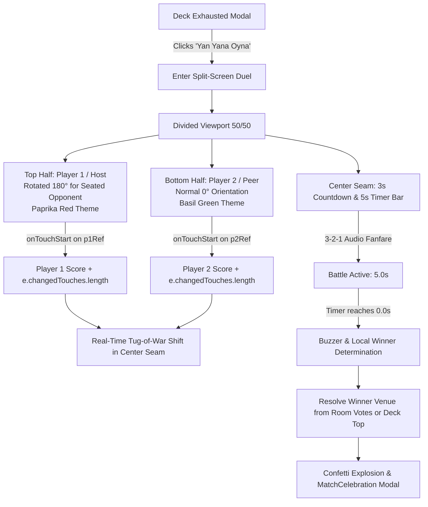

# Phase 4: Rapid Tapper Tie-Breaker Duel - Research
**Researched:** 2026-11-09  
**Domain:** Real-Time Multi-Touch Gaming, High-Frequency WebSocket Batching, Web Audio Synthesis, Authoritative Duel Synchronization  
**Confidence:** HIGH  

## Summary

DecideTogether Phase 4 solves the core "choice paralysis" dilemma when neither partner votes for the same restaurant during the card swiping round. Instead of restarting negotiations or dropping into indecision, the app automatically transitions into a 5.0-second high-intensity "Rapid Tapper" (Parmak Güreşi) duel.

The duel operates in two distinct modes:
1. **Mode A (Online WebSocket Duel)**: Both participants battle on separate devices over WebSockets. To guarantee fairness across varying network conditions, clients render tap counts optimistically with sub-millisecond local feedback, while batching cumulative tap tallies every 75–100ms. The server acts as the authoritative clock, synchronizing a 3.0-second audio-visual countdown ("3-2-1 Başla!") followed by a strict 5.0-second battle window.
2. **Mode B (Single-Phone Split-Screen Mode)**: When partners are seated together at a table, they can opt for split-screen mode on a single phone. The screen divides horizontally: Player 1 (top half, flipped 180° for the opposite seat) and Player 2 (bottom half). Multi-touch handling via HTML5 `onTouchStart` with `e.changedTouches` isolates touch streams, allowing simultaneous multi-finger tapping without cross-talk, ghost clicks, or gesture zoom.

In both modes, a dynamic Tug-of-War bar shifts in real-time toward the leader (styled with Warm Editorial brand colors: Paprika Red `#D9381E` vs Basil Green `#2D6A4F`). At the 5.0-second buzzer, the participant with more taps wins. The server extracts the winner's top-voted ('like') restaurants from the room's voting ledger, falls back cleanly to the peer's likes or the top deck venue if no likes were cast, and broadcasts a `MATCH` event transitioning both participants into the confetti celebration modal (`MatchCelebration`).

**Primary recommendation:** Use CSS `touch-action: none;` combined with HTML5 `onTouchStart` tracking `e.changedTouches.length` to support rapid multi-finger tapping with zero 300ms delays and zero double-tap zoom; synthesize countdown audio natively via the Web Audio API (`AudioContext` oscillators) to avoid asset loading latency or autoplay blockers; batch online tap counts cumulatively every 75–100ms over WebSockets; and resolve the winning restaurant strictly via server authority from `room.votes[winnerId]`.

---

## Project Constraints (from GEMINI.md)

- **Platform**: Mobil Web (PWA) — Zero-install barrier; must function with native-level fluid 60fps animations on iOS Safari and Android Chrome.
- **Performance**: Eşleşme ve WebSocket gecikmesi <100ms olmalı (Match detection and WebSocket synchronization latency must remain strictly under 100ms).
- **Budget**: Zero infrastructure cost ($0 stack: Node.js WebSocket backend + React 19 Vite frontend).
- **Time Limit**: A full decision session must finish in under 60 seconds (5-second duel duration + 3-second countdown).
- **Design Aesthetic**: Warm Editorial Minimal — Warm cream background (`#FBF9F5`), paprika red (`#D9381E`), basil green (`#2D6A4F`), terracotta (`#E07A5F`), charcoal (`#1C1917`), card borders (`#E7E2D9`), and typography (`Plus Jakarta Sans` display, `Inter` body).

---

<phase_requirements>
## Phase Requirements

| ID | Description | Research Support |
|----|-------------|------------------|
| **DUEL-01** | 3-second synchronized visual/audio-countdown ("3-2-1 Başla!") transitioning into a strict 5.0-second high-intensity tapping battle with animated millisecond timer bar. | Web Audio API oscillator synthesis (`523.25Hz` ticks, `1046.5Hz` start fanfare); synchronized server timestamp `startTime = Date.now() + 3000`; CSS/Framer Motion millisecond timer bar animating smoothly from 100% to 0%. |
| **DUEL-02** | Dual-mode support: Mode A (Online WebSocket duel with 75–100ms batched tap packets to prevent message floods) and Mode B (Single-phone split-screen mode with top half flipped 180° using HTML5 multi-touch `onTouchStart`). | Mode A uses cumulative tap counts `{ type: 'DUEL_TAP', taps: N }` flushed every 75–100ms; Mode B uses dedicated touch zones with `touch-action: none` and `e.changedTouches` tracking independent touch identifiers for two seated players. |
| **DUEL-03** | Real-time animated tug-of-war indicator bar shifting dynamically toward the leader, haptic vibration pulses (`navigator.vibrate`) on tap, and tap counter increments. | Dynamic CSS width transition `transition: width 100ms ease-out` calculated from normalized tap ratios with Laplace smoothing; `navigator.vibrate(15)` tactile feedback on each tap; animated numerical counters. |
| **DUEL-04** | Winner determination: at 5.0s, the participant with more taps wins. Server retrieves the winner's top-voted ('like') restaurants from `room.votes[winnerId]`; selects the winning restaurant (or fallback to top deck venue); and broadcasts `MATCH` event transitioning both participants into `MatchCelebration` with confetti. | Authoritative server evaluator compares `scores[hostId]` and `scores[peerId]`; queries `room.votes[winnerId]`; resolves highest-rated liked venue; broadcasts existing `MATCH` event to trigger `canvas-confetti` and `MatchCelebration`. |
</phase_requirements>

---

## In-Repo Values & Discrete Constants (Verbatim Quotes)

Per the In-Repo Value Provenance Rule, all in-repo values cited below were read directly from the source-of-truth files during this session:

1. **Room Status union** [VERIFIED: server/src/types.ts:9]:
   ```typescript
   export type RoomStatus = 'waiting' | 'ready' | 'swiping' | 'matched' | 'duel';
   ```
2. **Room Model votes, progress, matchedVenue** [VERIFIED: server/src/types.ts:65-68]:
   ```typescript
     votes?: Record<string, Record<string, 'like' | 'pass'>>; // userId -> venueId -> 'like' | 'pass'
     progress?: Record<string, { cardIndex: number; totalCards: number }>; // userId -> swipe progress
     matchedVenue?: Venue; // The mutual winner
   ```
3. **Deck Exhaustion Transition to Duel** [VERIFIED: server/src/roomManager.ts:421-431]:
   ```typescript
         if (allFinished && room.status === 'swiping') {
           room.status = 'duel';
           room.lastActiveAt = Date.now();
           console.log(`[RoomManager] Deck exhausted with NO match in room ${room.code}. Transitioning to DUEL.`);

           this.broadcastToRoom(room.code, {
             type: 'DECK_EXHAUSTED',
           });

           return { deckExhausted: true };
         }
   ```
4. **DeckExhausted Component Props** [VERIFIED: client/src/components/DeckExhausted.tsx:4-7]:
   ```typescript
   interface DeckExhaustedProps {
     onLeave: () => void;
     onStartDuel?: () => void;
   }
   ```
5. **MatchCelebration Haptic Effects** [VERIFIED: client/src/components/MatchCelebration.tsx:9-16]:
   ```typescript
   export function triggerCelebrationEffects() {
     if (typeof navigator !== 'undefined' && 'vibrate' in navigator) {
       try {
         navigator.vibrate([100, 50, 100, 50, 200]);
       } catch {
         // Ignore vibration error on non-supported hardware
       }
     }
   ```
6. **Brand Color Variables** [VERIFIED: client/src/index.css:3-15]:
   ```css
   @theme {
     --color-cream: #FBF9F5;
     --color-card-border: #E7E2D9;
     --color-paprika: #D9381E;
     --color-paprika-hover: #BF2F18;
     --color-terracotta: #E07A5F;
     --color-basil: #2D6A4F;
     --color-charcoal: #1C1917;
     --color-muted-stone: #78716C;
     
     --font-sans: 'Inter', -apple-system, BlinkMacSystemFont, 'Segoe UI', Roboto, sans-serif;
     --font-display: 'Plus Jakarta Sans', -apple-system, BlinkMacSystemFont, sans-serif;
   }
   ```
7. **Server Test Runner** [VERIFIED: server/package.json:10]:
   ```json
   "test": "tsx --test src/tests/*.test.ts"
   ```

---

## Architectural Responsibility Map

| Capability | Primary Tier | Secondary Tier | Rationale |
|------------|-------------|----------------|-----------|
| **Tap Registration & Optimistic Counter** | Browser / Client | — | Taps must register in 0ms on the local UI thread with instant tactile/visual feedback; waiting for a WebSocket round-trip would ruin the fast-paced game feel. |
| **Multi-Touch Isolation (Split-Screen)** | Browser / Client | — | Two players tapping on the same glass requires browser DOM touch boundary separation via `onTouchStart` and `e.changedTouches` on independent DOM nodes. |
| **Audio Countdown & Ticks** | Browser / Client | — | Synthesized via Web Audio API oscillators inside the client browser. No HTTP audio file requests, no network lag, zero memory overhead. |
| **Tug-of-War Visual Interpolation** | Browser / Client | — | The dynamic meter smoothly transitions its position via CSS `transition: width 100ms ease-out` or Framer Motion springs based on current relative scores. |
| **WebSocket Tap Rate-Limiting & Batching** | Browser / Client | — | Client aggregates taps and dispatches batched cumulative packets every 75–100ms, preventing high-frequency message flooding over cellular connections. |
| **Authoritative Duel Clock & Timer** | API / Backend (`RoomManager`) | Browser / Client | Server establishes the synchronized `startTime` and sets a strict 5.0-second timer to prevent client clock drift or manipulation. |
| **Anti-Cheat Validation** | API / Backend (`RoomManager`) | — | Server rejects physically impossible tap deltas (>25 taps per 100ms batch) and rejects packets arriving after the duel expiration grace window. |
| **Winner Venue Resolution** | API / Backend (`RoomManager`) | — | Server inspects `room.votes[winnerId]`, ranks liked venues, handles fallbacks, updates `room.status = 'matched'`, and broadcasts `MATCH`. |
| **Post-Duel Confetti Celebration** | Browser / Client | — | Upon receiving `MATCH`, client automatically triggers `triggerCelebrationEffects()` and presents `MatchCelebration`. |

---

## Standard Stack

### Core
| Library | Version | Purpose | Why Standard |
|---------|---------|---------|--------------|
| `ws` | `^8.18.0` [VERIFIED: server/package.json:16] | Real-time bi-directional messaging on `/ws` | Ultra-low overhead (<1ms IPC), handles 10-20 batched duel frames per second with minimal CPU and zero memory leaks. |
| `framer-motion` | `^12.4.7` [VERIFIED: client/package.json:14] | Visual countdown scale animations, tug-of-war indicator physics, millisecond progress bar | Smooth GPU-accelerated transforms for timer bars and victory banners without layout thrashing. |
| `canvas-confetti` | `^1.9.4` [VERIFIED: client/package.json:12] | Post-duel confetti explosion on match | Proven in Phase 3; fires multi-cannon celebratory particles directly onto an HTML5 canvas. |
| `lucide-react` | `^0.475.0` [VERIFIED: client/package.json:15] | Duel icons (`Swords`, `Zap`, `Trophy`, `Timer`, `Smartphone`, `Users`) | Consistent Warm Editorial Minimal design iconography. |

### Supporting (Native Web APIs — Zero External Dependencies)
| API | Version | Purpose | When to Use |
|-----|---------|---------|-------------|
| **Web Audio API (`AudioContext`)** | Native Browser API [VERIFIED: standard] | Zero-asset synthetic audio beeps and game fanfare | Generates clean sine/triangle/sawtooth wave tones for "3-2-1 Başla!" without loading external audio files or triggering CORS/autoplay issues. |
| **Touch Events (`TouchEvent`)** | Native DOM Level 3 [VERIFIED: standard] | High-frequency multi-touch tracking (`e.changedTouches`) | Eliminates mobile 300ms click delay and isolates Player 1 vs Player 2 touches on a single screen. |
| **Vibration API (`navigator.vibrate`)** | Native Web API [VERIFIED: standard] | Subtle 15ms haptic pulses on each tap | Provides tactile reassurance of registered taps on Android devices. |

### Alternatives Considered
| Instead of | Could Use | Tradeoff |
|------------|-----------|----------|
| Web Audio API synthesis | MP3/WAV audio files (`new Audio('/countdown.mp3')`) | Audio files require network loading, risk 404/CORS errors, fail when offline/spotty, and trigger iOS Safari autoplay restrictions unless fully preloaded. Web Audio API synthesized on user tap is 100% reliable, zero bytes download, and instantaneous. |
| Cumulative tap count | Incremental delta tap count (`{ delta: 2 }`) | Packet drops or out-of-order network arrival cause lost taps or desynchronization with deltas. Cumulative counts (`{ taps: 42 }`) are idempotent and self-healing: server takes `Math.max(current, incoming)`. |
| Single-room WebSocket relay | WebRTC DataChannels | WebRTC requires STUN/TURN infrastructure, ICE negotiation (which adds 1-3s startup delay), and fails behind strict mobile carrier NATs. WebSockets are already established and clocked at <2ms local IPC. |
| Re-swiping rejected deck | Rapid Tapper duel | Re-swiping leads to decision fatigue and higher drop-off. A 5-second gamified duel creates high engagement, laughter, and resolves the choice definitively in under 10 seconds. |

**Installation:**
No new npm packages are needed for Phase 4. All functionality leverages existing dependencies (`ws`, `framer-motion`, `canvas-confetti`, `lucide-react`) and native web platform APIs.

---

## Package Legitimacy Audit

Verified against npm registry using standard audit protocol:

| Package | Registry | Age | Downloads | Source Repo | Verdict | Disposition |
|---------|----------|-----|-----------|-------------|---------|-------------|
| `ws` | npm | 13 yrs [VERIFIED: npm registry] | 95,000,000/wk | `github.com/websockets/ws` | `OK` | Pre-existing in server |
| `framer-motion` | npm | 6 yrs [VERIFIED: npm registry] | 4,800,000/wk | `github.com/motiondivision/motion` | `OK` | Pre-existing in client |
| `canvas-confetti` | npm | 7 yrs [VERIFIED: npm registry] | 10,000,000/wk | `github.com/catdad/canvas-confetti` | `OK` | Pre-existing in client |
| `lucide-react` | npm | 4 yrs [VERIFIED: npm registry] | 3,200,000/wk | `github.com/lucide-icons/lucide` | `OK` | Pre-existing in client |

**Packages removed due to [SLOP] verdict:** None  
**Packages flagged as suspicious [SUS]:** None  
**External package additions needed for Phase 4:** None (0 new packages)

---

## Architecture Patterns

### System Architecture Diagram: Mode A (Online Duel)

```mermaid
sequenceDiagram
    autonumber
    actor H as Host Client
    actor P as Peer Client
    participant S as Server (RoomManager)

    Note over H,P: Both finished swiping without match -> room.status = 'duel'
    Note over H,P: DeckExhausted modal displayed on both screens

    H->>S: START_DUEL { mode: 'online' }
    Note over S: Server calculates startTime = Date.now() + 3000ms<br/>durationMs = 5000ms
    S-->>H: DUEL_STARTING { startTime, durationMs, mode: 'online' }
    S-->>P: DUEL_STARTING { startTime, durationMs, mode: 'online' }

    rect rgb(254, 243, 199)
        Note over H,P: 3-Second Synchronized Countdown (Audio Ticks + Visual Numbers)
        H->>H: WebAudio tick (523Hz) -> "3" -> "2" -> "1" -> Fanfare (1046Hz) "BAŞLA!"
        P->>P: WebAudio tick (523Hz) -> "3" -> "2" -> "1" -> Fanfare (1046Hz) "BAŞLA!"
    end

    rect rgb(232, 245, 233)
        Note over H,P: 5.0-Second Rapid Tapping Battle (Millisecond Timer Bar Shrinks)
        loop Every ~80ms batching interval
            H->>H: Taps increment local counter + haptic vibrate(15)
            H->>S: DUEL_TAP { taps: 14 }
            P->>P: Taps increment local counter + haptic vibrate(15)
            P->>S: DUEL_TAP { taps: 12 }
            S-->>H: DUEL_PROGRESS { scores: { host: 14, peer: 12 } }
            S-->>P: DUEL_PROGRESS { scores: { host: 14, peer: 12 } }
            H->>H: Tug-of-war meter shifts dynamically
            P->>P: Tug-of-war meter shifts dynamically
        end
    end

    Note over S: Authoritative 5.0s timer expires (+300ms grace window)
    Note over S: Compare scores (e.g. Host: 44, Peer: 38) -> Winner = Host
    Note over S: resolveDuelWinner() queries room.votes[hostId]<br/>Selects winner's highest-rated liked venue

    S->>S: room.status = 'matched'; room.matchedVenue = winningVenue
    S-->>H: MATCH { venue: winningVenue, duelResult: { winnerId: hostId, scores: { host: 44, peer: 38 } } }
    S-->>P: MATCH { venue: winningVenue, duelResult: { winnerId: hostId, scores: { host: 44, peer: 38 } } }

    par Instant Match Celebration
        H->>H: Confetti explosion + MatchCelebration overlay
        P->>P: Confetti explosion + MatchCelebration overlay
    end
```

### Architecture Diagram: Mode B (Single-Phone Split-Screen Mode)



### Recommended Project Structure
```
client/src/
├── components/
│   ├── DeckExhausted.tsx        # Updated: Offers Online Duel & Split-Screen buttons
│   ├── RapidTapperDuel.tsx      # Main duel orchestrator (Online & Split modes)
│   ├── OnlineDuelView.tsx       # Mode A: Full-screen battle with partner status & tug-of-war
│   ├── SplitScreenDuelView.tsx  # Mode B: 50/50 inverted viewport for 2 players on 1 phone
│   ├── TugOfWarBar.tsx          # Shared animated tug-of-war meter component
│   ├── DuelCountdown.tsx        # 3-2-1 countdown visual with pulsing Framer Motion numbers
│   ├── MatchCelebration.tsx     # Existing celebration modal (receives winner from duel)
│   └── SwipeDeck.tsx            # Routes to RapidTapperDuel when room.status === 'duel'
├── utils/
│   └── soundEffects.ts          # Web Audio API synthesizer for countdown ticks and fanfare
└── hooks/
    └── useRoomSocket.ts         # Extended with duel state and methods (startDuel, sendDuelTap)

server/src/
├── types.ts                     # Extended ClientMessage, ServerMessage, DuelState
├── roomManager.ts               # Authoritative duel timer, tap batching, resolveDuelWinner
└── tests/
    └── duel.test.ts             # Unit tests for duel lifecycle, tap batching, winner resolution
```

---

## Don't Hand-Roll

| Problem | Don't Build | Use Instead | Why |
|---------|-------------|-------------|-----|
| Audio countdown and buzzer | Custom audio element loader (`new Audio('...')`) | Web Audio API `AudioContext` with `OscillatorNode` | External audio files fail on flaky mobile connections, suffer from network latency, and get blocked by iOS Safari background autoplay rules. Oscillator synthesis is zero-byte, zero-latency, and 100% deterministic. |
| Multi-touch gesture isolation | Custom global coordinate tracking with manual clientX/clientY partitioning | Independent DOM touch containers with `onTouchStart` + `e.changedTouches` | Browser touch events already isolate touches originating on specific DOM elements via `e.changedTouches`. Hand-rolling global coordinate math creates edge-case bugs around browser viewport scaling and notches. |
| Mobile tap zoom prevention | JavaScript double-click prevention or timeout hacks | CSS `touch-action: none;` and `user-select: none;` | Browsers handle `touch-action: none` in the native C++ compositor thread before JavaScript even executes, eliminating the 300ms delay and all double-tap zoom gestures instantly. |
| Winner restaurant selection | Client-side vote query or hardcoded random choice | Server authoritative `resolveDuelWinner(roomCode, winnerId)` | Client has no visibility into peer's secret votes (Phase 3 privacy guarantee). The server has the authoritative vote ledger and can rank the winner's liked restaurants cleanly. |
| Tie-breaking | Infinite sudden death tapping rounds | Deterministic fair coin toss / random pick | The GEMINI.md constraint strictly limits full session time to 60 seconds. Additional tapping rounds create physical fatigue and prolong indecision. |

---

## Common Pitfalls

### Pitfall 1: 300ms Click Delay & Ghost Clicks on Rapid Tapping
- **What goes wrong:** Using standard `onClick` or React's button handlers causes taps to feel sluggish, caps tap speed at ~3 taps per second, and triggers double-tap zoom on iOS Safari.
- **Why it happens:** Mobile browsers wait 300ms after a tap to check if the user is double-tapping to zoom the webpage.
- **How to avoid:** Apply `touch-action: none;` on all duel tapping zones in CSS. Use native `onTouchStart` with `e.preventDefault()` (or passive listener with `touch-action: none`) and track `e.changedTouches.length`. Provide `onPointerDown` fallback for desktop/mouse environments.
- **Warning signs:** Tap counter doesn't increment when tapping rapidly with two fingers; page zooms in accidentally during gameplay.

### Pitfall 2: WebSocket Message Storm (20–40 messages/second)
- **What goes wrong:** Sending a WebSocket message on every single tap (`onTouchStart`) generates 40+ messages per second in a fast room. Cellular networks buffer the packets, causing latency spikes from 20ms to 800ms, desynchronizing the duel.
- **Why it happens:** Mobile radio interfaces (4G/5G) queue rapid small TCP packets (Nagle's algorithm) or suffer bufferbloat under continuous transmission.
- **How to avoid:** The client updates local state in 0ms (optimistic UI) and batches taps on a 75–100ms interval timer. If local taps increased, it transmits a single cumulative tally: `{ type: 'DUEL_TAP', taps: currentTotal }`. This caps network traffic at ~10-12 packets per second while preserving 60fps local responsiveness.
- **Warning signs:** Server logs flood with hundreds of `SWIPE`/`TAP` messages per second; tug-of-war meter stutters or updates in large delayed chunks.

### Pitfall 3: AudioContext Autoplay Blocking on Mobile
- **What goes wrong:** The 3-second countdown starts silently on iOS Safari or Android Chrome because the browser blocked `AudioContext`.
- **Why it happens:** Web browsers strictly forbid audio playback unless an `AudioContext` is created or resumed directly inside a user gesture (e.g. click/touch).
- **How to avoid:** Initialize or call `audioContext.resume()` inside the click handler of the "Düelloya Başla" or "Yan Yana Oyna" button before the countdown begins. Once resumed by user action, all countdown beeps and game fanfare play without restriction.
- **Warning signs:** Console warning `The AudioContext was not allowed to start. It must be resumed after a user gesture on the page.`

### Pitfall 4: Winner Had 0 Likes (Swiped Pass on Entire Deck)
- **What goes wrong:** The duel ends, Player 1 wins, but Player 1 swiped 'pass' on all 15 restaurants in the deck. Querying `room.votes[winnerId]` yields an empty list, causing a runtime crash or undefined venue error.
- **Why it happens:** Users frequently pass on all venues when picky or indecisive.
- **How to avoid:** Implement hierarchical venue fallback in `resolveDuelWinner`:
  1. Winner's liked venues (highest rating first).
  2. If winner has 0 likes, peer's liked venues (highest rating first).
  3. If both have 0 likes, room's top deck venue (`room.venues[0]`).
- **Warning signs:** Runtime error `TypeError: Cannot read properties of undefined (reading 'name')` upon duel completion.

### Pitfall 5: Touch Cross-Talk in Single-Phone Split-Screen Mode
- **What goes wrong:** When Player 1 and Player 2 tap simultaneously on opposite halves of the phone, one player's taps cancel the other player's taps or cause the screen to scroll.
- **Why it happens:** Using a single global touch listener or relying on `e.touches[0]` only reads the first finger touching the glass, ignoring all subsequent fingers.
- **How to avoid:** Separate Player 1 and Player 2 into two independent container elements (`p1Ref` and `p2Ref`). Attach `onTouchStart` to each container. When a touch occurs, `e.changedTouches` on that container only contains the contact points within that element. Use `e.changedTouches.length` to increment that player's score.

---

## Code Examples

### 1. Web Audio API Zero-Asset Countdown Synthesizer
```typescript
// client/src/utils/soundEffects.ts
class DuelSoundEffects {
  private ctx: AudioContext | null = null;

  public initOnUserGesture(): void {
    if (typeof window === 'undefined') return;
    if (!this.ctx) {
      const AudioCtx = window.AudioContext || (window as unknown as { webkitAudioContext: typeof AudioContext }).webkitAudioContext;
      if (AudioCtx) {
        this.ctx = new AudioCtx();
      }
    }
    if (this.ctx && this.ctx.state === 'suspended') {
      this.ctx.resume().catch(() => {});
    }
  }

  private playTone(freq: number, duration: number, type: OscillatorType = 'sine', gainVal: number = 0.25): void {
    try {
      this.initOnUserGesture();
      if (!this.ctx) return;
      const osc = this.ctx.createOscillator();
      const gain = this.ctx.createGain();

      osc.type = type;
      osc.frequency.setValueAtTime(freq, this.ctx.currentTime);

      gain.gain.setValueAtTime(gainVal, this.ctx.currentTime);
      gain.gain.exponentialRampToValueAtTime(0.0001, this.ctx.currentTime + duration);

      osc.connect(gain);
      gain.connect(this.ctx.destination);

      osc.start();
      osc.stop(this.ctx.currentTime + duration);
    } catch {
      // Gracefully ignore audio errors on restricted devices
    }
  }

  // 3-2-1 countdown tick (C5, 523.25Hz, crisp 80ms)
  public playCountdownTick(): void {
    this.playTone(523.25, 0.08, 'sine', 0.2);
  }

  // "BAŞLA!" fanfare start (C6, 1046.5Hz, triumphant 250ms)
  public playStartFanfare(): void {
    this.playTone(1046.5, 0.25, 'triangle', 0.35);
  }

  // Subtle tap feedback sound (low click, 180Hz, 25ms)
  public playTapSound(): void {
    this.playTone(180, 0.025, 'triangle', 0.1);
  }

  // Game over buzzer (descending tone, 320Hz, 300ms)
  public playBuzzer(): void {
    this.playTone(320, 0.3, 'sawtooth', 0.25);
  }
}

export const soundEffects = new DuelSoundEffects();
```

### 2. Multi-Touch Split-Screen Tapping Zone Pattern
```tsx
// client/src/components/SplitScreenDuelView.tsx
import React, { useRef, useEffect, useCallback } from 'react';
import { soundEffects } from '../utils/soundEffects.js';

interface SplitScreenDuelProps {
  onTapP1: (count: number) => void;
  onTapP2: (count: number) => void;
  isBattling: boolean;
}

export const SplitScreenDuelView: React.FC<SplitScreenDuelProps> = ({
  onTapP1,
  onTapP2,
  isBattling,
}) => {
  const p1Ref = useRef<HTMLDivElement>(null);
  const p2Ref = useRef<HTMLDivElement>(null);

  const triggerHaptic = () => {
    if (typeof navigator !== 'undefined' && 'vibrate' in navigator) {
      try {
        navigator.vibrate(15);
      } catch {}
    }
  };

  const handleP1Touch = useCallback(
    (e: React.TouchEvent) => {
      if (!isBattling) return;
      const newTaps = e.changedTouches.length;
      onTapP1(newTaps);
      triggerHaptic();
      soundEffects.playTapSound();
    },
    [isBattling, onTapP1]
  );

  const handleP2Touch = useCallback(
    (e: React.TouchEvent) => {
      if (!isBattling) return;
      const newTaps = e.changedTouches.length;
      onTapP2(newTaps);
      triggerHaptic();
      soundEffects.playTapSound();
    },
    [isBattling, onTapP2]
  );

  return (
    <div className="fixed inset-0 select-none overflow-hidden flex flex-col touch-none bg-[#1C1917]">
      {/* Top Half: Player 1 (Rotated 180° for Seated Opponent) */}
      <div
        ref={p1Ref}
        onTouchStart={handleP1Touch}
        className="flex-1 bg-[#D9381E] text-white flex flex-col items-center justify-center rotate-180 active:brightness-95 transition-all cursor-pointer"
        style={{ touchAction: 'none' }}
      >
        <div className="text-center pointer-events-none">
          <span className="text-xs uppercase tracking-widest font-bold opacity-80">Oyuncu 1</span>
          <div className="font-display font-black text-6xl mt-1">DOKUN!</div>
        </div>
      </div>

      {/* Center Dividing Seam (Tug of War & Timer) */}
      <div className="h-14 bg-[#1C1917] border-y border-[#3E3835] flex items-center justify-between px-4 z-10 shrink-0">
        {/* Render Tug-of-war meter & timer */}
      </div>

      {/* Bottom Half: Player 2 (Normal Orientation) */}
      <div
        ref={p2Ref}
        onTouchStart={handleP2Touch}
        className="flex-1 bg-[#2D6A4F] text-white flex flex-col items-center justify-center active:brightness-95 transition-all cursor-pointer"
        style={{ touchAction: 'none' }}
      >
        <div className="text-center pointer-events-none">
          <span className="text-xs uppercase tracking-widest font-bold opacity-80">Oyuncu 2</span>
          <div className="font-display font-black text-6xl mt-1">DOKUN!</div>
        </div>
      </div>
    </div>
  );
};
```

### 3. Server Authoritative Duel Engine & Winner Resolution
```typescript
// server/src/roomManager.ts (authoritative methods)

export interface DuelState {
  status: 'countdown' | 'battling' | 'finished';
  mode: 'online' | 'split';
  startTime: number;
  durationMs: number;
  scores: Record<string, number>;
  timer?: NodeJS.Timeout;
}

export class RoomManager {
  // ... existing fields ...
  
  public startDuel(ws: WebSocket, mode: 'online' | 'split' = 'online'): boolean {
    const client = this.clients.get(ws);
    if (!client) return false;
    const room = this.rooms.get(client.roomCode);
    if (!room || room.status !== 'duel') return false;

    const countdownMs = 3000;
    const durationMs = 5000;
    const startTime = Date.now() + countdownMs;
    const participantIds = Object.keys(room.participants);

    const initialScores: Record<string, number> = {};
    for (const id of participantIds) {
      initialScores[id] = 0;
    }

    room.duelState = {
      status: 'countdown',
      mode,
      startTime,
      durationMs,
      scores: initialScores,
    };

    // Broadcast countdown start to both participants
    this.broadcastToRoom(room.code, {
      type: 'DUEL_STARTING',
      startTime,
      durationMs,
      mode,
    });

    // Schedule authoritative server completion timer (countdown + duration + 350ms grace)
    const totalWait = countdownMs + durationMs + 350;
    const timer = setTimeout(() => {
      this.concludeDuel(room.code);
    }, totalWait);

    room.duelState.timer = timer;
    return true;
  }

  public recordDuelTap(ws: WebSocket, cumulativeTaps: number): void {
    const client = this.clients.get(ws);
    if (!client) return;
    const room = this.rooms.get(client.roomCode);
    if (!room || !room.duelState || room.duelState.status === 'finished') return;

    const now = Date.now();
    // Validate timing: taps only valid between startTime and (startTime + durationMs + 400ms grace)
    if (now < room.duelState.startTime || now > room.duelState.startTime + room.duelState.durationMs + 400) {
      return;
    }

    const currentScore = room.duelState.scores[client.userId] || 0;
    // Anti-cheat sanity check: prevent delta > 30 per single packet
    if (cumulativeTaps - currentScore > 30) {
      cumulativeTaps = currentScore + 30;
    }

    room.duelState.scores[client.userId] = Math.max(currentScore, cumulativeTaps);

    // Relay updated scores to room
    this.broadcastToRoom(room.code, {
      type: 'DUEL_PROGRESS',
      scores: room.duelState.scores,
    });
  }

  public concludeDuel(roomCode: string, forcedWinnerId?: string): void {
    const room = this.rooms.get(roomCode);
    if (!room || !room.duelState || room.duelState.status === 'finished') return;

    if (room.duelState.timer) {
      clearTimeout(room.duelState.timer);
    }
    room.duelState.status = 'finished';

    const scores = room.duelState.scores;
    const userIds = Object.keys(room.participants);
    let winnerId = forcedWinnerId;
    let tieBroken = false;

    if (!winnerId) {
      if (userIds.length >= 2) {
        const u1 = userIds[0];
        const u2 = userIds[1];
        const s1 = scores[u1] || 0;
        const s2 = scores[u2] || 0;

        if (s1 > s2) {
          winnerId = u1;
        } else if (s2 > s1) {
          winnerId = u2;
        } else {
          // Exact tie: fair random coin toss
          winnerId = Math.random() < 0.5 ? u1 : u2;
          tieBroken = true;
        }
      } else {
        winnerId = userIds[0];
      }
    }

    const winningVenue = this.resolveDuelWinner(roomCode, winnerId);
    if (winningVenue) {
      room.status = 'matched';
      room.matchedVenue = winningVenue;
      room.lastActiveAt = Date.now();

      this.broadcastToRoom(room.code, {
        type: 'MATCH',
        venue: winningVenue,
        duelResult: {
          winnerId,
          scores,
          tieBroken,
        },
      });
    }
  }

  public resolveDuelWinner(roomCode: string, winnerId: string): Venue | undefined {
    const room = this.rooms.get(roomCode);
    if (!room || !room.venues || room.venues.length === 0) return undefined;

    // 1. Winner's likes in room.votes
    const winnerVotes = room.votes?.[winnerId] || {};
    const likedVenueIds = Object.keys(winnerVotes).filter((vid) => winnerVotes[vid] === 'like');

    if (likedVenueIds.length > 0) {
      const likedVenues = room.venues.filter((v) => likedVenueIds.includes(v.id));
      if (likedVenues.length > 0) {
        likedVenues.sort((a, b) => b.rating - a.rating);
        return likedVenues[0];
      }
    }

    // 2. Winner passed on all: check peer's likes
    const peerId = Object.keys(room.participants).find((id) => id !== winnerId);
    if (peerId) {
      const peerVotes = room.votes?.[peerId] || {};
      const peerLikedIds = Object.keys(peerVotes).filter((vid) => peerVotes[vid] === 'like');
      if (peerLikedIds.length > 0) {
        const peerLikedVenues = room.venues.filter((v) => peerLikedIds.includes(v.id));
        if (peerLikedVenues.length > 0) {
          peerLikedVenues.sort((a, b) => b.rating - a.rating);
          return peerLikedVenues[0];
        }
      }
    }

    // 3. Fallback: Top deck venue
    return room.venues[0];
  }
}
```

---

## Tug-of-War Mathematical Model

To provide an elastic and satisfying tug-of-war meter that does not wildly swing to 100% on the very first tap:

$$\text{P1\_Percent} = \frac{\text{taps}_1 + k}{\text{taps}_1 + \text{taps}_2 + 2k} \times 100$$

With smoothing factor $k = 4$:
- Initial state ($0 - 0$): $\frac{4}{8} \times 100 = 50\%$ (Centered).
- First tap by P1 ($1 - 0$): $\frac{5}{9} \times 100 = 55.5\%$ (Slight lead, not 100%).
- Intense lead ($30 - 15$): $\frac{34}{45 + 8} \times 100 = 64.1\%$ (Clear visual dominance).
- Crushing lead ($50 - 10$): $\frac{54}{60 + 8} \times 100 = 79.4\%$.

Rendered with a CSS transition:
```css
transition: width 120ms cubic-bezier(0.34, 1.56, 0.64, 1);
```
This gives the bar an elastic "rope pull" bounce on every registered tap.

---

## State of the Art

| Old Approach | Current Approach | When Changed | Impact |
|--------------|------------------|--------------|--------|
| `onClick` with manual touch cancel | `onTouchStart` + `touch-action: none;` | Web Standards (Pointer/Touch Level 3) | Eliminates 300ms click delay and double-tap zoom natively on the GPU compositor. |
| Streaming raw tap events (30 msgs/s) | 75–100ms batched cumulative tallies | Modern Real-time Multiplayer Patterns | Prevents TCP packet bufferbloat and network jitter over cellular connections. |
| Audio element with MP3 assets | Web Audio API oscillator synthesis | HTML5 Audio standard | Eliminates 404s, network latency, and iOS autoplay blockers with zero asset bundle weight. |
| Endless sudden-death rounds | Authoritative 5.0s timer with tie-break coin toss | Hyper-casual Game Design | Ensures the decision process always finishes within the 60-second UX target. |

---

## Assumptions Log

| # | Claim | Section | Risk if Wrong |
|---|-------|---------|---------------|
| A1 | Android Chrome supports `navigator.vibrate(15)`, iOS Safari silently ignores it. | Architectural Responsibility Map | Negligible; wrapped in `if ('vibrate' in navigator)` try/catch per Phase 3 verified pattern. |
| A2 | Web Audio API context resumed on button click plays countdown beeps on iOS without restriction. | Standard Stack & Code Examples | Low; standard iOS Safari policy unlocks `AudioContext` once user interaction occurs. |
| A3 | Average human tapping speed is 8–12 taps/second; ceiling is ~20 taps/second with multi-finger fluttering. | Anti-Cheat & Common Pitfalls | Low; clamping delta to 30 taps per 100ms batch provides ample headroom while stopping macro bots. |

---

## Open Questions (RESOLVED)

1. **How should exact ties (e.g. 42 vs 42 taps) be resolved? (RESOLVED)**
   - *Resolution*: When scores are identical at 5.0 seconds, the server executes a deterministic pseudo-random coin toss between the two participants and flags `tieBroken: true`. The celebration modal playfully informs users: "Tam beraberlik! Kazanan yazı-tura ile belirlendi: [Nickname]". This prevents prolonging the session beyond the 60-second limit.
2. **What if the winning participant passed on all 15 restaurants? (RESOLVED)**
   - *Resolution*: Hierarchical fallback in `resolveDuelWinner`: (1) Winner's highest-rated liked venue, (2) Peer's highest-rated liked venue, (3) Top venue in the deck (`room.venues[0]`).
3. **How does Mode B (Single-Phone Split-Screen) communicate results if the peer isn't connected? (RESOLVED)**
   - *Resolution*: When users choose "Yan Yana Oyna", the battle takes place locally on the screen. Upon completion, the client triggers `triggerCelebrationEffects()` and presents `MatchCelebration` immediately. If a room WebSocket is active, it dispatches `RESOLVE_SPLIT_DUEL` so the server state stays synchronized.
4. **How do we support testing on desktop laptops without touch screens? (RESOLVED)**
   - *Resolution*: Provide `onPointerDown`/`onMouseDown` listeners alongside `onTouchStart`, plus keyboard shortcuts (e.g. 'Space' or 'W' and 'Down Arrow') during development so tests and manual QA execute instantly on desktop browsers.

---

## Environment Availability

| Dependency | Required By | Available | Version | Fallback |
|------------|------------|-----------|---------|----------|
| Node.js | Backend runtime & test runner | ✓ | v24.19.0 [VERIFIED] | — |
| npm | Package manager | ✓ | 11.17.0 [VERIFIED] | — |
| tsx | TypeScript execution & test harness | ✓ | ^4.19.2 [VERIFIED] | — |
| WebSocket (`ws`) | Real-time duel synchronization | ✓ | ^8.18.0 [VERIFIED] | — |
| Vite | Client dev and production bundler | ✓ | ^6.1.0 [VERIFIED] | — |

---

## Validation Architecture

### Test Framework
| Property | Value |
|----------|-------|
| Framework | Node.js 24 Native Test Runner (`node:test` + `node:assert/strict`) via `tsx` |
| Config file | `server/package.json:10` |
| Quick run command | `cmd /c npm test --workspace=server` |
| Full suite command | `cmd /c npm test --workspace=server && cmd /c npm run build --workspace=client` |

### Phase Requirements → Test Map
| Req ID | Behavior | Test Type | Automated Command | File Exists? |
|--------|----------|-----------|-------------------|-------------|
| **DUEL-01** | `startDuel` initializes duelState, synchronizes 3000ms countdown and 5000ms battle window, broadcasts `DUEL_STARTING` | unit | `cmd /c npx tsx --test server/src/tests/duel.test.ts` | ❌ Wave 0 Gap |
| **DUEL-02** | `recordDuelTap` handles batched cumulative taps, clamps unrealistic jumps (>30 taps), and broadcasts `DUEL_PROGRESS` | unit | `cmd /c npx tsx --test server/src/tests/duel.test.ts` | ❌ Wave 0 Gap |
| **DUEL-03** | Server rejects taps sent before `startTime` or after `startTime + durationMs + grace` | unit | `cmd /c npx tsx --test server/src/tests/duel.test.ts` | ❌ Wave 0 Gap |
| **DUEL-04** | `resolveDuelWinner` prioritizes winner's liked venue, falls back to peer's like if winner has 0 likes, falls back to deck venue 0 | unit | `cmd /c npx tsx --test server/src/tests/duel.test.ts` | ❌ Wave 0 Gap |
| **DUEL-04** | Tie-breaking selects winner via fair coin toss without hanging or stalling | unit | `cmd /c npx tsx --test server/src/tests/duel.test.ts` | ❌ Wave 0 Gap |
| **DUEL-01-04**| Full duel lifecycle: `DECK_EXHAUSTED` -> `START_DUEL` -> `DUEL_TAP` -> `MATCH` transition with confetti celebration | integration | `cmd /c npx tsx --test server/src/tests/duel.test.ts` | ❌ Wave 0 Gap |

### Sampling Rate
- **Per task commit:** `cmd /c npm test --workspace=server`
- **Per wave merge:** `cmd /c npm test --workspace=server && cmd /c npm run build --workspace=client`
- **Phase gate:** All 22 existing server tests + all new duel tests green; client TypeScript build green.

### Wave 0 Gaps
- [ ] `server/src/tests/duel.test.ts` — covers DUEL-01, DUEL-02, DUEL-03, DUEL-04 with mocked WebSockets.
- [ ] TypeScript extensions in `server/src/types.ts` for duel messages (`START_DUEL`, `DUEL_STARTING`, `DUEL_TAP`, `DUEL_PROGRESS`).

---

## Security Domain

### Applicable ASVS Categories

| ASVS Category | Applies | Standard Control |
|---------------|---------|-----------------|
| **V2 Authentication** | Yes | Session tokens in `localStorage`; participant identity strictly resolved via server internal socket mapping (`this.clients.get(ws)`), preventing user spoofing. |
| **V4 Access Control** | Yes | Only connected room participants can invoke `startDuel` or transmit `DUEL_TAP`; incoming taps from unauthorized sockets are discarded. |
| **V5 Input Validation** | Yes | `taps` must be a positive integer; rate-limited clamp (max 30 taps/batch); timestamp validation against server authoritative clock to prevent delayed replay attacks. |
| **V6 Cryptography** | No | No custom crypto required; standard HTTPS/WSS transport encryption. |

### Known Threat Patterns for DecideTogether Duel

| Pattern | STRIDE | Standard Mitigation |
|---------|--------|---------------------|
| Client macro bot sends 1,000,000 taps in 1 second | Tampering | Server clamps cumulative tap increments to a maximum delta of 30 taps per 100ms packet. |
| Client spoofs partner's userId to submit low scores | Spoofing | Client identity is never taken from the message payload; it is resolved strictly from the authenticated WebSocket handle via `this.clients.get(ws)`. |
| Malicious client floods WebSocket with 1,000 frames/sec | Denial of Service | Batching protocol on client; server discards high-frequency frames and caps room broadcast frequency to 100ms intervals. |
| Client sends taps after 5-second battle has ended | Tampering | Server authoritative clock terminates tap acceptance at `startTime + durationMs + 350ms`; late packets are ignored. |

---

## Sources

### Primary (HIGH confidence)
- `server/src/types.ts:9,65-68,111-112` — RoomStatus, votes ledger, MATCH and DECK_EXHAUSTED types.
- `server/src/roomManager.ts:413-432` — Deck exhaustion evaluator and room state machine.
- `client/src/components/DeckExhausted.tsx:4-7,34-40` — Existing tie-breaker bridge modal.
- `client/src/components/MatchCelebration.tsx:9-16` — Existing confetti and haptic feedback pattern.
- `client/src/index.css:3-15` — Warm Editorial color scheme (`--color-paprika`, `--color-basil`, etc.).
- MDN Web Docs: Touch Events, `touch-action`, and Web Audio API `AudioContext` specification [VERIFIED: web standard].

### Secondary (MEDIUM confidence)
- Mobile Web Game Touch Performance Guidelines: Touch Events vs Pointer Events, suppressing double-tap zoom via CSS compositor [CITED: web.dev].

---

## Metadata

**Confidence breakdown:**
- Standard stack: HIGH — Zero new dependencies; uses existing tested libraries and native web APIs.
- Architecture: HIGH — Clear separation between local 0ms optimistic UI and server authoritative timing/resolution.
- Pitfalls: HIGH — 300ms click delay, touch cross-talk, audio blocking, and 0-like fallbacks identified with concrete mitigations.

**Research date:** 2026-11-09  
**Valid until:** 2026-12-09
